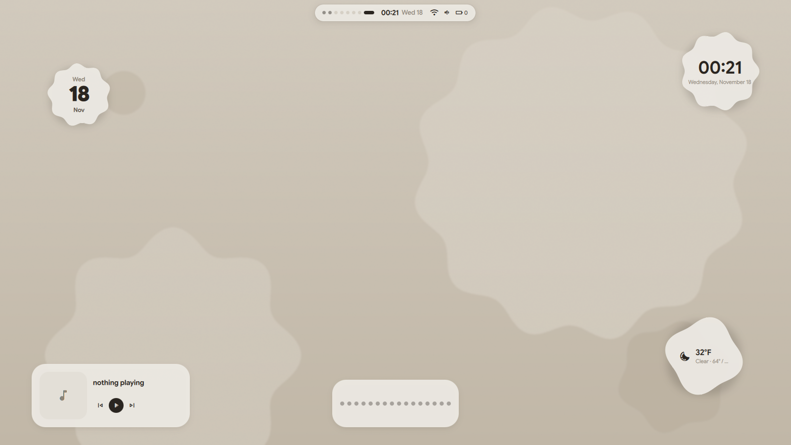
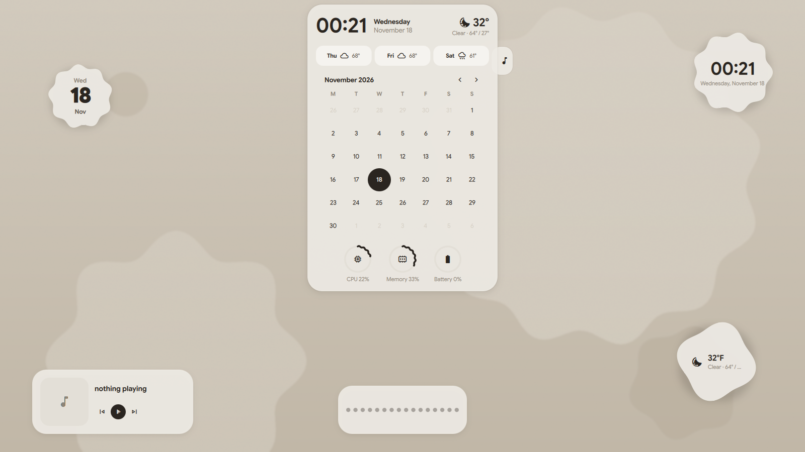
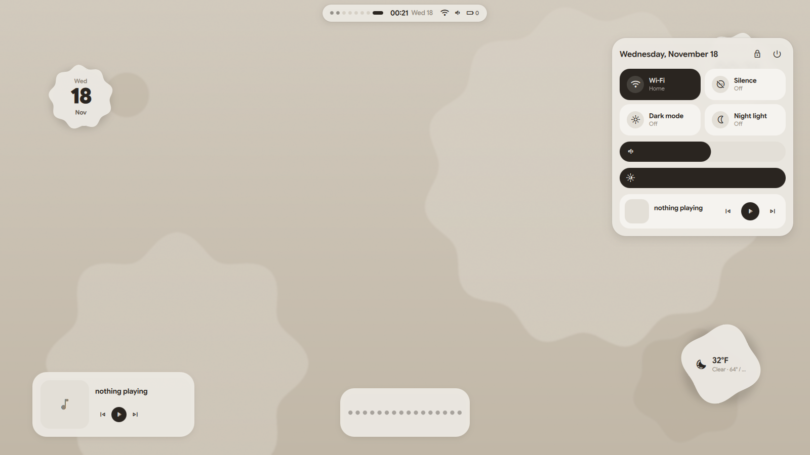
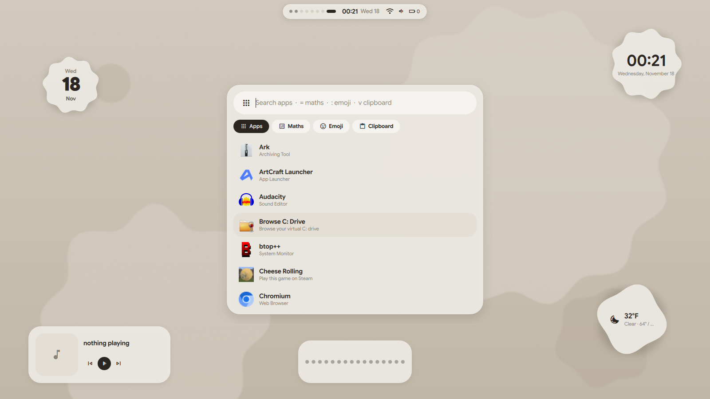
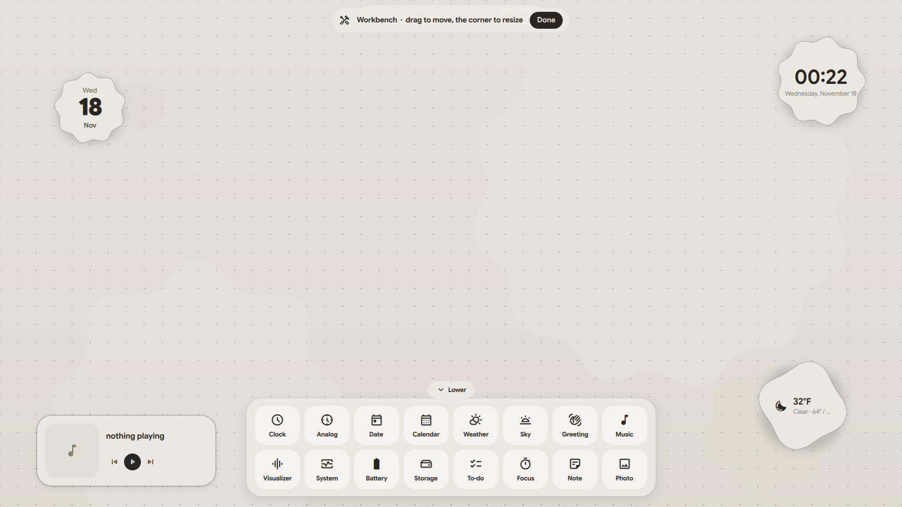
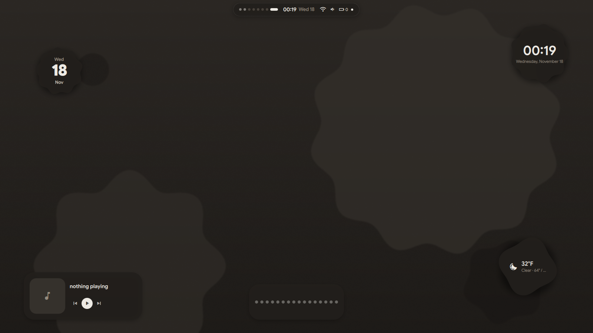
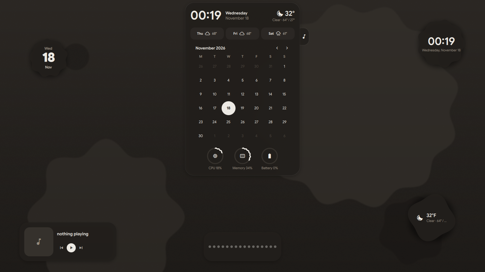
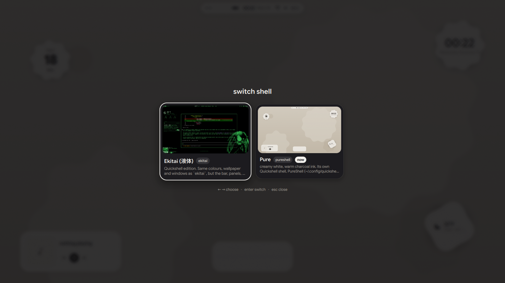

<p align="center">
  <picture>
    <source media="(prefers-color-scheme: dark)" srcset="assets/logo/wordmark-dark.png">
    
  </picture>
</p>

<p align="center"><b>A calm, soft desktop for Hyprland.</b><br>
Everything you need, nothing shouting at you. Free, forever.</p>

<p align="center"></p>

Most desktops want your attention. PureShell gets out of the way. One small island sits at the top of your
screen and tells you the time; when something happens (a song changes, a message comes in, the volume moves) it
gently swells open to show you, then settles back. Everything else is a click or a key away, and every bit of it
moves like it's soft: springy, unhurried, quiet.

It's built with [Quickshell](https://quickshell.org), runs smooth on a ten-year-old ThinkPad, and replaces your
bar, notifications, launcher, OSD and widgets in one go.

## Your day, one click away

Click the clock and the island opens into your day: the time, the weather and the next three days, the month,
and how your machine's doing, drawn as gentle wavy rings. A tab on its side turns it into a music player, with
the cover, a wavy progress line you can drag, and the controls.

<p align="center"> </p>

**Quick settings** (`SUPER + A`) have what you reach for: wifi, bluetooth, silence, night light, dark mode,
volume and brightness, and what's playing. **Notifications** (`SUPER + N`) wait for you, grouped by app, with
their buttons, until you clear them.

## Find anything

`SUPER + R` and start typing. Apps come up as you type, ranked the way you'd expect (`ffx` finds Firefox). Start
with `=` for a calculator, `:` for emoji, or `v` for everything you've copied lately.

<p align="center"></p>

## A desktop you arrange like a workbench

Sixteen widgets: a clock, an analog clock, the date in a flower, a calendar, the weather, the sky outside, a
greeting, music, a visualizer, your CPU and memory, battery, storage, a to-do list, a focus timer, notes and
photos. Put any of them in a shape (cookies, clovers, flowers, squircles…) and turn the shape however you like;
what's inside stays upright.

`SUPER + W` opens the workbench: a grid appears, you drag widgets where you want them (a ghost shows where
they'll land, and they spring into place), pull new ones out of the drawer, and reshape them. Done is one click.

<p align="center"></p>

## Light or dark

Cream by day, warm charcoal by night: one tap in quick settings, and the whole desktop (your terminal and window
borders too) glides over.

<p align="center"> </p>

## Switch shells without a flash

Want something louder some days? PureShell works with [ShellSwitcher](https://github.com/BugzySleeps/ShellSwitcher):
`SUPER + ALT + S` shows every shell you've got, each as you last left it, and swaps to the one you pick under a
cover of your screen, so there's no blink, no blank bar, just a fade.

<p align="center"></p>

## Light on your laptop

PureShell only builds the big screens when you open them, reads Hyprland directly instead of starting programs
every second, and keeps still when nothing's happening. It was built on, and for, a 2014 ThinkPad T440.

## Get it

PureShell is the shell half of the `pure` rice in my [dotfiles](https://github.com/BugzySleeps/bugzysdotfiles):
the dotfiles bring its colours, fonts and the little helper scripts.

```sh
rice pure            # with the dotfiles: the theme, then this shell (rice pure-dark for dark)
qs -c pureshell      # or just the shell
```

**Keys:** `SUPER + R` launcher · `SUPER + A` quick settings · `SUPER + N` notifications · `SUPER + W` the
workbench · `SUPER + SHIFT + V` clipboard · click the clock for your day.

Prefer a full bar along the top to the island? `qs -c pureshell ipc call settings barStyle bar`.

**Needs:** Quickshell (Qt 6.9+) and Hyprland 0.57+; PipeWire, NetworkManager, UPower, BlueZ; `brightnessctl`,
`cava`, `wl-clipboard`, `grim`. The weather comes from open-meteo.com (no account, no key).

## Licence

Free to use and to change for yourself, not to copy into other projects or republish. See [LICENSE](LICENSE).
