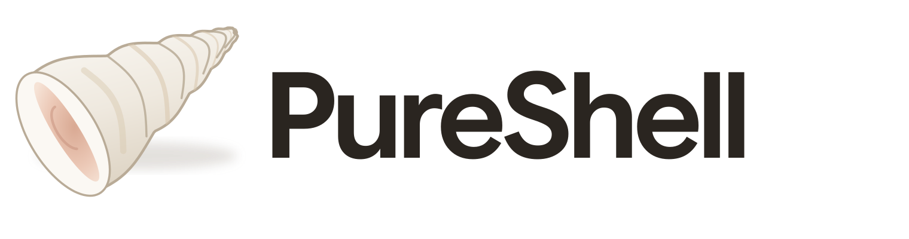

<p align="center">
  <picture>
    <source media="(prefers-color-scheme: dark)" srcset="assets/logo/wordmark-dark.png">
    
  </picture>
</p>

# PureShell

A [Quickshell](https://quickshell.org) shell for Hyprland in creamy white (`#edeae4`) and one warm charcoal ink:
Google Sans Flex, Material Symbols, soft round shapes and springy motion.

It's the shell half of the `pure` rice in my [dotfiles](https://github.com/BugzySleeps/bugzysdotfiles), which
provide the colours (the `rice` theme switcher writes `~/.local/state/rice/palette.json`), the fonts and the
helper scripts it calls. `rice pure` switches to it.

## What's in it

- **the island** (the default): a cream pill at the top that's the clock, with the workspaces and the status
  either side. It springs open for what's happening, then shrinks back: volume and brightness, a new track (the
  cover, the title, a few bars moving with it), notifications.
- **the bar** (`barStyle: "bar"`): a slim cream bar along the top instead, the workspaces on the left, the
  status on the right and the island in the middle.
- **the wallpaper**: drawn by the shell, fading between them. Any wallpaper works; the cream stays cream.

- **the Today card**: click the clock and the island opens into the time, the weather (and the next three days),
  the month, and CPU, memory and battery as wavy rings.
- **quick settings** (SUPER + A, or a click on the status): wifi, bluetooth, silence, night light; volume and
  brightness; what's playing.
- **notifications** (SUPER + N, or a click on the dot): kept until cleared, grouped by app, with their buttons.
- **the launcher** (SUPER + R): apps; `=` maths, `:` emoji, `v` the clipboard (SUPER + SHIFT + V).
- **desktop widgets**: a clock, the date in a flower, a calendar, the weather, music, a note; any of them in a
  shape (cookies, clovers, a flower…). SUPER + W opens the **workbench**: the grid shows, drag a widget to move
  it or its corner to resize it (a ghost shows where it'll land, and it springs there), and the drawer holds every
  kind to add, and the picked one's shape.
- Claude Code's "✻ done / needs you" in the island (the dotfiles' `claude-island` hook).

More is on the way: settings, a lock screen.

## Run it

```sh
rice pure                         # from the dotfiles: the theme, then this shell
qs -c pureshell                   # or just the shell
qs -c pureshell ipc call settings barStyle bar     # the bar instead of the island ("island" back)
```

## Needs

- Quickshell (Qt 6.9+), Hyprland 0.57+ (its Lua config)
- Google Sans Flex and Material Symbols Rounded (in the dotfiles' `fonts/`)
- PipeWire, NetworkManager, UPower, BlueZ; `brightnessctl` for brightness; `cava` for the moving bars;
  `wl-clipboard` for the clipboard; the weather is open-meteo.com (no key)

## The logo

A spiral seashell in creamy whites (a soft peach inside its mouth), in `assets/logo/`: the shell (`logo`), an app icon (`icon`) and the wordmark, each with a
`-dark` version. `python3 assets/logo/make.py` draws them all again (it needs `rsvg-convert`).

## Licence

See [LICENSE](LICENSE): free to run and to change for yourself, not to copy into other projects or republish.
